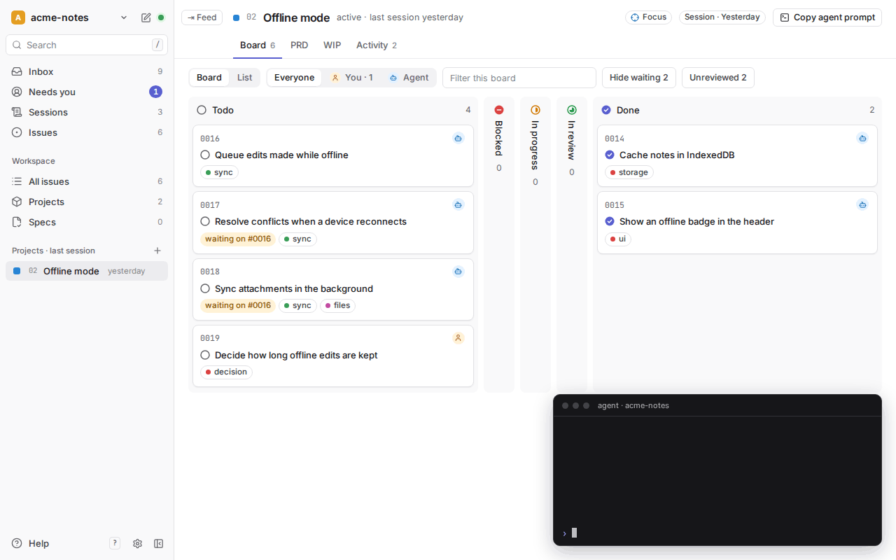

# loopboard

**A local, Linear-like board for the issues, PRDs and specs you and your
coding agents keep as markdown in your repo.** Agents write the files; you
steer from the board; nothing leaves your machine.

<picture>
  <source media="(prefers-color-scheme: dark)" srcset="docs/media/demo-dark.gif">
  
</picture>

<!-- Recorded by `pnpm demo` (scripts/demo/); CI re-records it when the UI changes. -->

- **Files, not a service.** Issues, PRDs and specs live in `.agents/` next to
  your code. Git is the history; there's no account and no database.
- **Built for working with agents.** Skills for Claude Code, Cursor and Codex
  take a plan from interview to PRD to vertical-slice issues to verified,
  done work.
- **One board for every repo.** Run it once; switch repos from the top-left.
  It updates live while your agent edits files.

## Quick setup

Paste this into your agent (Claude Code, Cursor, Codex, …) in your repo:

```text
Set up the loopboard workflow in this repo:
1. Run `npx loopboard init`.
2. Follow .agents/SETUP.md: fill in AGENTS.md's overview and build/test/verify
   commands, keep any existing agent instructions, and ask me before importing
   existing TODOs as issues.
3. Run `npx loopboard` and tell me what you set up.
```

Prefer the terminal? `npx loopboard init`, then ask your agent to follow
`.agents/SETUP.md`.

## How you work with it

1. **Decide** — "grill me on …": your agent interviews you until the plan is
   clear.
2. **Plan** — "write a PRD for this": a project with `prd.md` and `wip.md`.
3. **Slice** — "break it into issues": vertical slices in `.agents/issues/`.
4. **Build** — "implement #0012": code, tests, verify, specs — then `done`.
5. **Steer** — watch the board. Anything that needs you shows up under
   **Needs you**.

More: [the loop](docs/the-loop.md) · [what lives where](docs/folder-map.md) ·
[statuses and fields](docs/statuses.md) · [working with AI agents](docs/learn/),
a short course on why this works. The app's **Help Center** (`?`) has all of
it, with an interactive loop, short videos, the upgrade guide, and links to
Matt Pocock's videos and writing.

## The harness

`loopboard init` sets up three things your agent reads:

- **`AGENTS.md`** — a managed *Workflow* block (the session loop, which docs
  to load when) plus your own project rules and build commands.
- **`.agents/skills/`** — grill-me, grill-with-docs, to-prd, to-issues,
  implement, triage, issue-grooming, upgrade-harness and routine (linked
  into `.claude/skills`).
- **`.agents/`** — issues, projects, routines (`scheduled/`), specs,
  architecture, rules and design, each with a README that explains its
  format.

Not a code repo? `npx loopboard init --kind docs` sets up the same loop in a
folder of documents — a company's paperwork, taxes, a move — with issues and
projects only: no specs, no skills, no links, and no git needed. An issue
there is done when its acceptance criteria are ticked and the evidence is
written down.

### Upgrade an existing harness

Workflow changes ship as numbered [migrations](MIGRATIONS.md). In a repo that
already uses these conventions (an `.agents/` or older `ai/` folder), ask your
agent: **"upgrade my loopboard harness"**. If the repo doesn't have that skill
yet (Help → Upgrade a harness fills in the path and shows which of your repos
are behind):

```text
Upgrade this repo's loopboard harness. Read
<path-to-loopboard>/.agents/skills/upgrade-harness/SKILL.md and follow it,
using <path-to-loopboard> as the upstream. Start with a report of what would
change, and ask before any bulk edits.
```

## CLI

| Command | Does |
|---|---|
| `npx loopboard [path]` | Opens the board for the repo (default: here) at `http://127.0.0.1:5180`. A running board adds the repo instead of starting another. `--port <n>`, `--no-open`. |
| `npx loopboard init [path]` | Sets up the workflow. `--with-extras` adds tdd, diagnose, improve-codebase-architecture and write-a-skill. |
| `npx loopboard init --upgrade` | Refreshes shipped files you haven't edited. `--force` overwrites edited ones, `--dry-run` only reports. |
| `npx loopboard init --kind docs [path]` | Sets up a folder without code — paperwork, taxes, a move: issues and projects, no specs, no skills, no links, no git needed. Writes the folder's id and name to `.agents/harness.md`; `--id`, `--name` and `--parent` set them. |
| `npx loopboard routines [path]` | Lists the harness's [routines](docs/routines.md) — recurring or one-time work in `.agents/scheduled/` — with the schedule in words, the next slot and the last run. `--under <dir>` covers every harness under a folder, `--json` prints them as data. |
| `npx loopboard routines due` | What is due now, for the one dispatcher per place. Files the period's issue of a `creates: issue` routine and records expired slots and aborted runs; `--json`, `--dry-run`. |
| `npx loopboard routines start <routine>` / `finish <routine> --status ok\|failed --note "…"` | Record a run's start and how it ended, in the routine's `runs.md`. |
| `npx loopboard routines prompt <routine>` / `dispatcher-prompt` | Print the brief for a run's sub-agent, or the dispatcher prompt to schedule on your agent platform. |
| `npx loopboard workspaces` | Lists the registered workspaces: id, name, path and whether the folder still exists. `--json` prints them as data. `workspaces forget <id>…` removes entries from the list, never a repo's files. |

Requires Node 20 or newer. The server binds to `127.0.0.1` and refuses
requests from other sites. Every command takes the repo as a path, so it runs
from any folder, and a flag it doesn't know stops it before anything is
written.

`npx loopboard` needs the published package. To run a clone of this repo
instead, build it and link it globally — `loopboard` is then on your PATH in
every folder:

```bash
pnpm install && pnpm build  # the CLI runs build/, not the sources
npm link                    # puts `loopboard` on your PATH
loopboard --version         # from any folder; build again after pulling
```

The board follows file changes through the operating system's file watcher
and says "Not live" when that stops working. On a network or synced folder
that reports no changes, start it with `LOOPBOARD_POLL_MS=2000` to also check
`issues/`, `projects/` and `specs/` every two seconds; a workspace where one
of them, the archive or a project folder is a symlink is checked that way on
its own.

## Contributing

This repo plans its own work with loopboard: the launch PRD is
[`.agents/projects/01-open-source-launch/`](.agents/projects/01-open-source-launch/prd.md),
behavior is specified in [`.agents/specs/`](.agents/specs/_specs.md), and the
design is in [`.agents/architecture/`](.agents/architecture/_architecture.md).
Report bugs and ideas as GitHub Issues — see [CONTRIBUTING.md](CONTRIBUTING.md).

```bash
pnpm install
pnpm dev                          # dev server for this repo's .agents/
BASE_PATH=../other-repo pnpm dev  # register and open another repo
pnpm verify                       # type-check + Vitest
pnpm test:e2e                     # Playwright against fixture repos
pnpm build && pnpm start ../repo  # the production CLI from source
pnpm build && npm link            # the same CLI as `loopboard`, in any folder
pnpm videos                       # re-render the Help Center videos (Remotion, see videos/)
```

## Credits and license

MIT — see [LICENSE](LICENSE). Several skills, and much of the thinking in the
course, are adapted from Matt Pocock's
[mattpocock/skills](https://github.com/mattpocock/skills); details in
[CREDITS.md](CREDITS.md).
